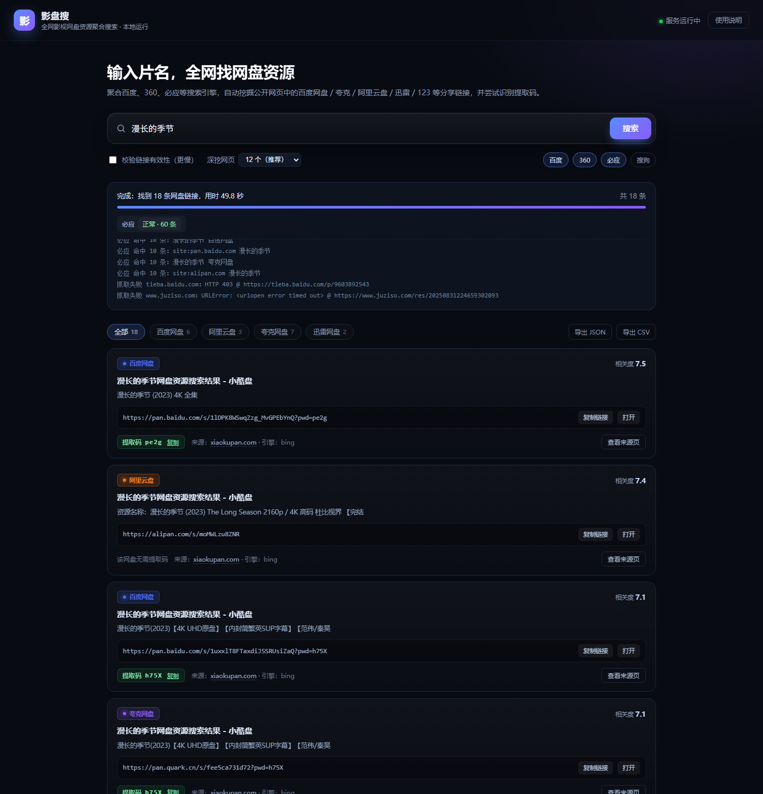

# 影盘搜 · 全网影视网盘资源聚合搜索

输入一个影视名称，自动到全网检索、深挖网页，把散落在公开页面里的**网盘分享链接**和**提取码**抓出来，去重排序后给你一份干净的结果列表。

支持：百度网盘、夸克网盘、阿里云盘、UC 网盘、迅雷网盘、123 网盘、115 网盘、天翼云盘、微云。



> 纯 Python 标准库实现，**不需要安装任何第三方依赖**；数据全部在本地，不上传、不代理、不存储任何文件。

---

## 一、快速开始

### 1. 环境

- Windows 10/11，Python **3.9 及以上**（安装时务必勾选 `Add Python to PATH`）
- 一条能正常访问百度/必应的网络即可，无需任何账号

检查是否装好：

```bat
python --version
```

### 2. 网页版（推荐）

双击 **`启动网页版.bat`**，浏览器会自动打开 `http://127.0.0.1:8765`，在搜索框里输入片名回车即可。

关闭那个黑色命令行窗口，服务就停止了。

### 3. 命令行版

```bat
:: 直接搜（最简）
python -m pansou "流浪地球2"

:: 校验链接是否失效 + 深度模式 + 导出 CSV
python -m pansou "庆余年 第二季" --check --deep --csv out\庆余年.csv

:: 指定引擎
python -m pansou "奥本海默" --engines baidu,so360

:: 离线自测（不联网，验证解析逻辑）
python -m pansou selftest
```

也可以直接双击 **`命令行搜索.bat`**，按提示输入片名。

---

## 二、结果怎么看

网页版每条结果是一张卡片：

| 元素 | 含义 |
| --- | --- |
| 网盘徽标 | 链接属于哪个网盘，颜色区分 |
| 链接有效 / 可能失效 | 勾选「校验链接有效性」后才会出现，未校验则不显示 |
| 相关度 | 综合片名匹配、清晰度（4K/1080P/蓝光）、中字、全集、有无提取码等算出的分数，越高越值得先看 |
| 备注 | 资源站自己写的说明，例如「漫长的季节 (2023) 4K 全集」 |
| 提取码 | 自动识别的 4 位码，点「复制」即可 |
| 来源 | 这条链接是从哪个网页挖到的，可点开核对 |

页面顶部可以按网盘类型筛选、导出 JSON / CSV。

---

## 三、工作原理

1. **查询规划**：把片名组合成多条查询，例如
   `片名 网盘 提取码`、`片名 4K 高清 下载`，以及 `site:pan.quark.cn 片名` 这类精准查询。
2. **多引擎检索**：同时请求百度、360、必应（可选搜狗 / Serper / 博查），收集候选网页。
3. **深挖网页**：按域名轮转挑出最有希望的页面（资源站、影评站、贴吧、微博文章……），
   逐个抓取正文；遇到必须登录的站点会整站跳过，省时间也少打扰对方。
4. **抽取与排序**：
   - 9 种网盘的链接正则，支持 `?pwd=`、`share/init?surl=` 等变体；
   - 提取码来自三处：链接自带的 `?pwd=` 参数、页面里 `{url, password}` 这类成对字段、
     链接前后的「提取码：xxxx」文字；
   - 同一分享去重、同一来源页限量、按相关度排序。

全程遵守「慢速 polite 抓取」：同一站点默认间隔 3 秒，结果缓存 6 小时，避免给目标站造成压力。

---

## 四、让结果更多的几个技巧

1. **片名写全**：`流浪地球2` 比 `流浪` 好；剧集加上季数，`庆余年 第二季`。
2. **把「深挖网页」调大**：12 个是平衡值，20~30 个命中更多（也更慢）。
3. **换引擎**：某个引擎显示「被拦截」时，取消勾选它，或等 5~10 分钟再试。
4. **勾选「校验链接有效性」**：会实际访问分享页，能过滤掉已失效的链接（慢，且可能被网盘限流）。
5. **配代理**：如果本机 IP 被搜索引擎限流，在 `config.json` 里设置 `request.proxy`。
6. **加 API Key**（可选，最稳）：
   - `api.serper_key`：<https://serper.dev> 的 Key，走 Google 结果
   - `api.bocha_key`：博查搜索 API，国内可直连
   填好后对应引擎会自动加入检索。

---

## 五、常见问题

**Q：某个引擎一直显示「被拦截」？**
搜索引擎对高频访问很敏感。程序已经把间隔放慢到 3 秒，但如果短时间内反复搜索仍会被拦。
等 5~10 分钟、取消勾选该引擎，或配置代理即可；日志里的提示不会影响其它引擎。

**Q：结果只有几条？**
可能原因：片名太短/太通用、目标站需要登录、搜索引擎临时限流。
建议：片名写全 + 深挖调大 + 多等一会儿重试。

**Q：提取码是空的？**
很多分享本来就不需要提取码（阿里云盘、夸克、微云）；也有的站点把提取码放在图片或评论里，程序读不到。
这种情况下点「打开」到分享页，通常会提示输入或直接可见。

**Q：双击 bat 窗口一闪而过 / 提示"不是内部或外部命令"？**
说明脚本没找到可用的 Python，或系统把 `python` 指向了微软商店的占位程序。脚本会自动尝试
`py -3` 和真正的 `python.exe`；如果仍失败，请安装 Python 3.9+ 并勾选 `Add Python to PATH`。
想看到具体报错：在文件夹地址栏输入 `cmd` 回车，然后执行 `启动网页版.bat`，错误会留在窗口里。

**Q：端口 8765 被占用？**
程序会自动往后找可用端口（8766、8767…），以窗口里打印的地址为准，也可以 `--port 9000` 指定。

**Q：想在手机上用？**
把 `config.json` 的 `web.host` 改成 `0.0.0.0`，用电脑局域网 IP 访问。
⚠️ 只在可信的家庭/办公局域网里这样做，不要暴露到公网。

**Q：为什么第一次搜索比较慢？**
要真的去搜索引擎查、再去网页里挖，一般 20~60 秒。相同片名 6 小时内再搜会命中缓存，几秒出结果。

---

## 六、配置项（config.json）

| 配置 | 默认 | 说明 |
| --- | --- | --- |
| `engines.baidu` / `so360` / `bing` | true | 启用的搜索引擎 |
| `engines.sogou` | false | 搜狗反爬严格，默认关闭 |
| `request.min_interval` | 3.0 | 同一站点请求最小间隔（秒），调小更快但更容易被封 |
| `request.timeout` | 15 | 单次请求超时 |
| `request.proxy` | "" | 例如 `http://127.0.0.1:7890` |
| `search.max_queries` | 6 | 每个引擎最多执行几条查询 |
| `search.crawl_pages` | 12 | 最多深挖多少个网页 |
| `search.workers` | 5 | 抓取并发 |
| `output.max_per_page` | 15 | 同一来源页最多保留几条，防止聚合站刷屏 |
| `output.max_results` | 60 | 最多输出多少条 |
| `check.enabled` | false | 是否默认校验链接有效性 |
| `api.serper_key` / `bocha_key` | "" | 可选搜索 API |
| `cache.ttl` | 21600 | 结果缓存秒数（0 表示总是重新抓） |
| `web.port` | 8765 | 网页版端口 |

改完配置重启程序即可生效。

---

## 七、目录结构

```
pansou/
├─ 启动网页版.bat          双击启动网页版
├─ 命令行搜索.bat          双击按提示搜索
├─ config.json             配置
├─ preview.png             界面截图
├─ README.md
└─ pansou/                 程序本体
   ├─ __main__.py          入口（python -m pansou）
   ├─ cli.py               命令行
   ├─ web.py               本地网页服务
   ├─ search.py            检索编排
   ├─ engines.py           各搜索引擎适配
   ├─ extract.py           网盘链接 / 提取码抽取与打分
   ├─ checker.py           链接有效性校验
   ├─ net.py               限速、重试、缓存、Cookie
   ├─ config.py            配置加载
   ├─ selftest.py          离线自测
   └─ static/index.html    网页界面
```

---

## 八、免责声明

- 本工具**只读取搜索引擎已收录的公开网页**，不提供、不存储、不上传、不代理任何影视文件，也不绕过任何付费/DRM 限制。
- 抓到的链接由第三方网盘用户分享，其合法性、安全性、有效性均与本工具无关；请自行甄别，谨防钓鱼与恶意文件。
- 请仅将本工具用于**查找你有权访问的内容**（例如自己购买/收藏的资源、公有领域作品、官方免费发布的内容），并遵守当地法律及各网盘服务条款。
- 请勿用于商业用途或大规模爬取；因使用本工具产生的一切后果由使用者自行承担。
